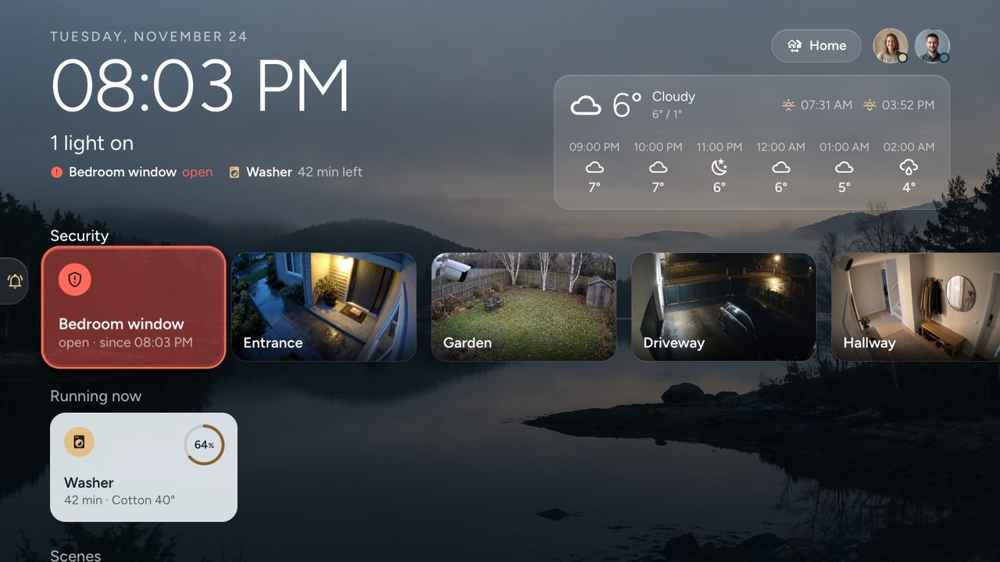
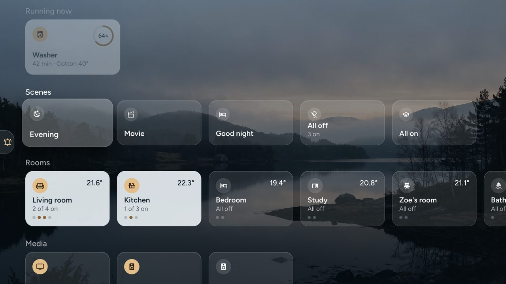
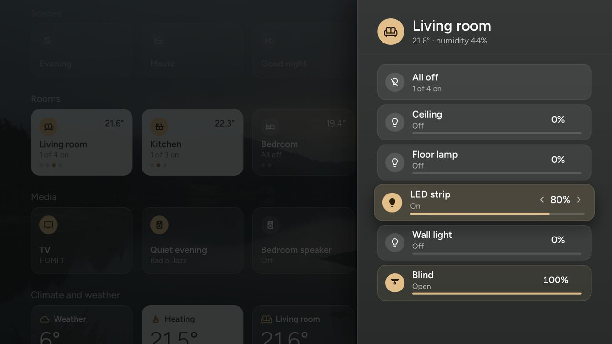
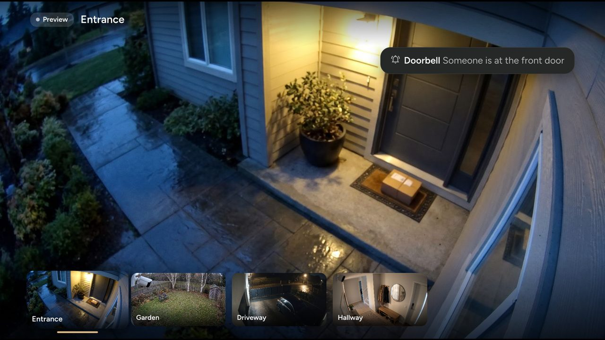
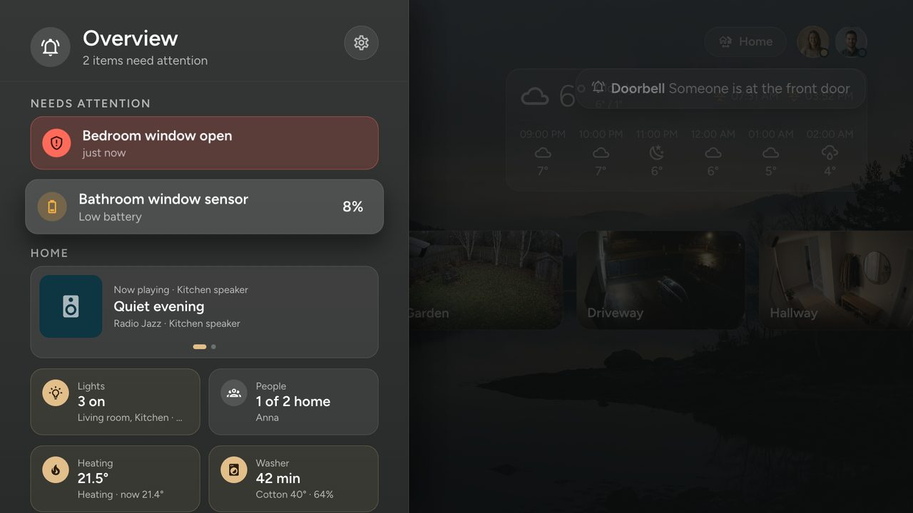
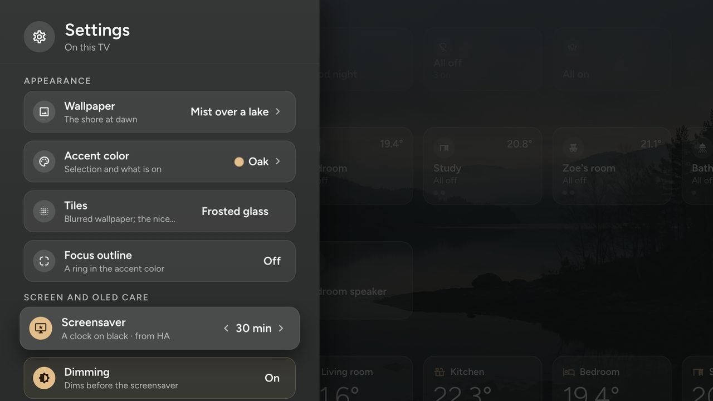

# Alvuna

Home Assistant on the TV. Install it, add the integration, open the app on the TV: your home is there, laid out for
the remote. Rooms from your areas, lights, scenes, weather, media, climate, cameras, the washing machine, waste
collection. Nobody builds a dashboard, and nothing is typed on the TV.

**Website and live demo: [alvuna.shipapp.pl](https://alvuna.shipapp.pl/en/)** ([po polsku](https://alvuna.shipapp.pl/))



- **A ready layout**: Alvuna builds it from Home Assistant's areas, floors and devices, and keeps it current as they
  change. It picks each room's thermometer, one player per TV, readable names, and recognises WashData appliances,
  waste calendars, air quality and weather warnings.
- **The Alvuna panel** in Home Assistant's sidebar, for administrators: hide what should not show, rename, reorder, add a
  script as a scene. Changes reach every TV at once.
- **Televisions** in the same panel: each TV with what it shows right now and when the remote was last used; commands
  (reload, home screen, screensaver, open a room or panel, a camera, a message) and the TV's own settings (wallpaper,
  accent, tiles, screensaver, OLED care), sent at once or when the TV next starts; its error log.
- **On the TV**, hold OK on a tile to hide it.
- **Pairing by code**: the TV shows a code; in Home Assistant, under Discovered, type it. Each TV gets its own user
  (not an administrator; local network only unless you allow a TV in another home), and removing it revokes it.
- **Several homes** on one TV, each paired on its own; **English and Polish**.

## Screenshots

From the sample home (made-up devices) that also runs on the [website](https://alvuna.shipapp.pl/en/).

| | |
|---|---|
|  |  |
| **Scenes and rooms**: OK runs a scene or opens a room | **A room**: lights, brightness, blinds |
|  |  |
| **Doorbell**: the camera opens full screen | **Overview**: what needs attention, what is on |
|  | |
| **Settings on the TV**: wallpaper, accent, frosted glass, OLED care | |

## Install

1. In Home Assistant open **Settings → Marketplace** (HACS on 2026.10 and older), add this repository as a custom
   repository (`https://github.com/endurance71/alvuna`, type *Integration*) and install **Alvuna**.
2. Open **Settings → Devices & services → Add integration → Alvuna** (the Marketplace may offer to set it up right
   away). No restart is needed to install; an update asks for one.

## TV

Install the Alvuna app (LG webOS; Android TV / Google TV in testing, see `tv-apps/androidtv`), or open `http://<your-home-assistant>:8123/alvuna/tv/` in the
TV's browser. The app finds Home Assistant on the network and shows a code: in Home Assistant, **Settings → Devices &
services → Discovered → Alvuna TV**, type the code and name the TV. Settings on the TV (gear in the summary panel): the
look of the tiles, screensaver and OLED care, homes (switch, rename, add, remove) and signing out.

Each paired TV is a device with a **Connected** sensor, and the actions `alvuna.notify` (a message on the TV) and
`alvuna.show_camera` (a camera full screen, e.g. when the doorbell rings) can target it.

## Requirements

- Home Assistant 2025.1 or newer.
- The TV must reach Home Assistant on the local network. Paired TV users are local-only.

## Development

```sh
cd frontend && npm ci && node build.mjs        # builds custom_components/alvuna/www
python -m venv .venv && .venv/bin/pip install -r requirements_test.txt
.venv/bin/pytest -q
scripts/dev-deploy.sh <ssh-host>                # copy to a test Home Assistant, then restart it
```

The built frontend (`custom_components/alvuna/www`) is committed, so an install from any commit works; CI fails when it
does not match the sources, so rebuild and commit it with every frontend change. Releases also attach `alvuna.zip`.

---

## Po polsku

Alvuna to Home Assistant na telewizorze: gotowy układ z obszarów i urządzeń, bez tworzenia dashboardów.
Strona i pokaz na żywo: [alvuna.shipapp.pl](https://alvuna.shipapp.pl/).

1. Zainstaluj ją z **Ustawienia → Marketplace** (albo z HACS) i dodaj integrację **Alvuna**. Instalacja nie wymaga
   restartu; aktualizacja o niego poprosi.
2. Telewizor: uruchom aplikację Alvuna (albo `/alvuna/tv/` w przeglądarce TV). W Home Assistancie, w sekcji
   *Wykryte*, wybierz **Alvuna TV** i wpisz kod z ekranu.

Układ powstaje sam z obszarów i pięter. W panelu **Alvuna** w menu bocznym ukryjesz elementy, zmienisz nazwy
i kolejność albo dodasz skrypt jako scenę, a w zakładce **Telewizory** zobaczysz, co pokazuje każdy telewizor, wyślesz
mu polecenie i zmienisz jego ustawienia; na telewizorze przytrzymanie OK na kaflu też pozwala go ukryć.
